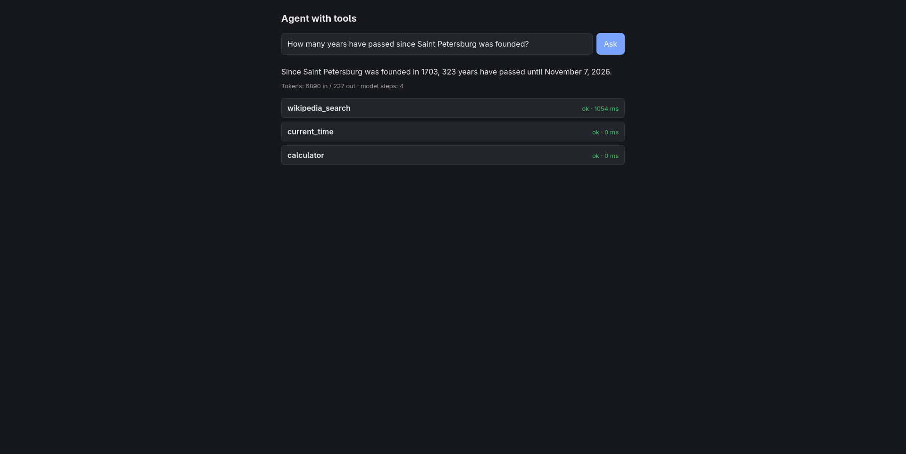
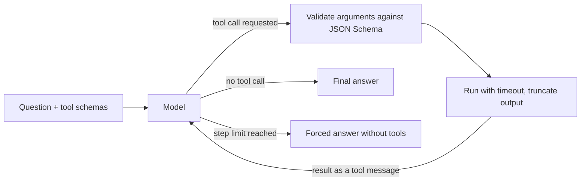

<div align="center">

# AgentApi

**An LLM agent that picks its own tools: calculator, clock, Wikipedia and your own documents.**
FastAPI · tool calling · live step feed · safety built into the design




</div>

---

## Overview

AgentApi is a small agent service. You ask a question, and the model decides what to do: answer directly, or call one or more tools, read the results and continue until it can answer. The model never executes code. It returns a structured request such as "call `calculator` with `{"expression": "2026 - 1703"}`", this service validates and runs the function, and the result is sent back to the model as the next message.

The model is any OpenAI-compatible endpoint that supports tool calling (for example Groq with `openai/gpt-oss-120b` or `llama-3.3-70b-versatile`). Document search is done over HTTP against the companion project [RagDocsApi](https://github.com/YOUR_USERNAME/RagDocsApi), so RAG becomes one tool among several.

## Features

- **The model chooses the tools.** Several tools can be requested in one step, and results of earlier steps feed later ones (look up a year, get the date, calculate the difference).
- **Live step feed.** The web UI shows every tool call under the answer: arguments, result, status and duration. Each step is collapsible.
- **Four built-in tools.** Calculator, current time, Wikipedia search and search over your own documents.
- **Loop protection.** A hard step limit, then one last model call without tools that forces a text answer. Repeated identical calls are not executed twice.
- **Errors are text for the model.** Unknown tool, malformed JSON, schema violation, timeout, tool crash: nothing raises, the model gets a clear message and can correct itself.
- **Tool results are untrusted data.** The system prompt says so, the UI renders them as plain text, and the model controls only query strings, never URLs.
- **Safe markdown answers.** Rendered with `marked` and sanitized with DOMPurify. Images are blocked so an injected `` cannot leak data.
- **Testable without a network.** The model call is injected, so tests use a fake model with scripted responses.
- **Measurable tool selection.** An evaluation script checks which tools the real model calls for a set of questions.
- **Reproducible setup.** One `compose up`, typed settings from environment variables.

## How it works



The model keeps no memory between calls, so every step resends the full history: system prompt, question, the model's own tool requests and all tool results. The `tool_call_id` links each result to the request it answers.

```
Browser ──POST /agent──► FastAPI ──► run_agent ──► Model (chat completions)
   ▲                                    │
   └────────── SSE events ◄─────────────┤
                                        └──► ToolRegistry.execute
                                               ├─ calculator, current_time   (local)
                                               ├─ wikipedia_search ──► Wikipedia API
                                               └─ search_documents ──► RagDocsApi GET /search
```

| Module | Responsibility |
|---|---|
| `app/agent.py` | System prompt and `run_agent`: the loop, loop guard, usage counting, events |
| `app/llm.py` | The model call (`complete`) with retries; injected into `run_agent` |
| `app/tools/base.py` | `Tool` (name, description, JSON Schema, function) and `ToolError` |
| `app/tools/registry.py` | Registration and safe execution: parse, validate, timeout, errors as text |
| `app/tools/builtin.py` | Builds the registry with all built-in tools |
| `app/tools/calculator.py` | Arithmetic expression evaluator, no `eval` |
| `app/tools/clock.py` | Current date and time in any IANA timezone |
| `app/tools/wikipedia.py` | Wikipedia open API search, intro paragraphs of up to 3 articles |
| `app/tools/documents.py` | HTTP client for RagDocsApi `/search` |
| `app/main.py` | `POST /agent` (SSE), `/health`, static UI |
| `app/static/index.html` | Web UI with the step feed and markdown rendering |
| `eval/run.py` | Tool-selection evaluation against the real model |

## Quick start

### Docker or Podman

```bash
git clone https://github.com/YOUR_USERNAME/AgentApi.git
cd AgentApi

cp .env.example .env            # then put your LLM API key into .env
docker compose up -d --build    # or: podman compose up -d --build
```

Open **http://localhost:8001**.

`search_documents` needs RagDocsApi running and reachable. Inside the container `localhost` is the container itself, so `docker-compose.yml` points `RAG_API_URL` at the host (`host.containers.internal` for Podman, `host.docker.internal` for Docker). RagDocsApi must publish its port and listen on `0.0.0.0`.

### Local development

```bash
python3.12 -m venv .venv
source .venv/bin/activate
pip install -r requirements-dev.txt

uvicorn app.main:app --port 8001 --reload
```

Port 8001 avoids a clash with RagDocsApi on 8000.

## Configuration

Settings come from environment variables or `.env`. Unknown variables are ignored.

| Variable | Description | Default |
|---|---|---|
| `LLM_BASE_URL` | OpenAI-compatible endpoint | none |
| `LLM_API_KEY` | API key for that endpoint | none |
| `LLM_MODEL` | Model name, must support tool calling | none |
| `MAX_AGENT_STEPS` | Maximum model/tool round trips before a forced answer | `6` |
| `TOOL_TIMEOUT_S` | Time limit for one tool run | `10` |
| `MAX_TOOL_OUTPUT_CHARS` | Tool output is truncated to this length | `4000` |
| `RAG_API_URL` | Base URL of RagDocsApi | `http://localhost:8000` |
| `RAG_TIMEOUT_S` | HTTP timeout for document search, keep below `TOOL_TIMEOUT_S` | `8` |

## Tools

| Tool | What it does | Notes |
|---|---|---|
| `calculator` | Exact arithmetic on an expression | Parsed safely, never `eval` |
| `current_time` | Date, time, weekday in an IANA timezone | Defaults to UTC |
| `wikipedia_search` | Intro paragraphs of up to 3 best articles | `ru` or `en`, one request, no API key |
| `search_documents` | Top fragments from your uploaded documents | URL comes from config only |

A tool is a name, a description, a JSON Schema for its arguments and a function (sync or async). The description is effectively a prompt: the model picks tools by it. Adding a tool means writing one file and registering it in `app/tools/builtin.py`.

## API

| Method | Path | Description |
|---|---|---|
| `POST` | `/agent` | Ask a question; the response is an SSE stream |
| `GET` | `/health` | Liveness check |
| `GET` | `/` | Web UI |

### Streaming protocol

`POST /agent` with `{"question": "..."}` returns `text/event-stream`. Example for a question that needs a lookup and a calculation:

```
data: {"type": "tool_call", "id": "call_a1", "name": "wikipedia_search", "arguments": "{\"query\": \"Saint Petersburg\"}"}

data: {"type": "tool_call", "id": "call_a2", "name": "current_time", "arguments": "{}"}

data: {"type": "tool_result", "id": "call_a1", "name": "wikipedia_search", "ok": true, "content": "## Saint Petersburg\n...", "ms": 640}

data: {"type": "tool_result", "id": "call_a2", "name": "current_time", "ok": true, "content": "{\"date\": \"2026-11-07\", ...}", "ms": 2}

data: {"type": "tool_call", "id": "call_b1", "name": "calculator", "arguments": "{\"expression\": \"2026 - 1703\"}"}

data: {"type": "tool_result", "id": "call_b1", "name": "calculator", "ok": true, "content": "323", "ms": 1}

data: {"type": "answer", "text": "Saint Petersburg was founded in **1703**, so **323 years** have passed."}

data: {"type": "usage", "in": 3100, "out": 150}

data: {"type": "done", "steps": 3}
```

| Event | Meaning |
|---|---|
| `tool_call` | The model asked for a tool (`arguments` is the raw JSON string) |
| `tool_result` | What the tool returned, `ok: false` with an error message if it failed, plus duration in `ms` |
| `answer` | The final text (markdown). `"truncated": true` if the step limit forced it |
| `usage` | Total tokens over all model calls of this run |
| `done` | The run is complete, `steps` is the number of model steps |
| `error` | The run crashed; includes a human-readable `message` |

```bash
curl -N -X POST http://localhost:8001/agent \
  -H "Content-Type: application/json" \
  -d '{"question": "How many years have passed since Saint Petersburg was founded?"}'
```

## Safety by design

| Risk | Protection |
|---|---|
| Endless loop | `MAX_AGENT_STEPS`, then a final call without tools forces an answer |
| Repeated or reworded calls | Identical calls (canonical JSON, key order ignored) are not executed twice; the system prompt limits retries |
| Malformed or wrong arguments | JSON parsing plus validation against the tool's JSON Schema before anything runs |
| Hanging tool | Per-tool timeout; sync tools run in a worker thread so they cannot block the event loop |
| Huge tool output | Truncated to `MAX_TOOL_OUTPUT_CHARS`, which also bounds token cost |
| Prompt injection via tool results | Results are marked as data in the system prompt; the agent has no dangerous tools (no file writes, no sending messages, no shell) |
| SSRF | The model supplies only query text; hosts and URLs are fixed in code and config |
| Code execution | The calculator uses a restricted expression parser, never `eval` |
| XSS in the UI | Tool results are rendered with `textContent`; the answer goes through DOMPurify |
| Data leak through images | `` is forbidden in rendered answers |
| Internal details leaking to the model | Unexpected exceptions are logged; the model only sees "failed unexpectedly" |

The system prompt reduces the risk of prompt injection but cannot eliminate it. The real protection is that the available tools cannot do harm.

## Evaluating tool selection

Whether the model picks the right tools is measured separately from the loop logic:

```bash
python3 -m eval.run
```

It reads `eval/questions.py`: each question lists the tools that **must** be called and the tools that **must not** be called. Questions the model can legitimately answer on its own only check the forbidden list. The script pauses between questions to stay under the provider's tokens-per-minute limit.

```
PASS  Hello!                                       called=[]
PASS  What is 17 * 23?                             called=['calculator']
PASS  How many years since Saint Petersburg ...    called=['calculator', 'current_time', 'wikipedia_search']
```

### Results

<!-- Fill this from your own runs. Model output is not deterministic: run the set 2-3 times
     and report how often each question passes. -->

| Model | Runs | Passed | Unstable questions |
|---|---|---|---|
| openai/gpt-oss-120b | | /  | |

What the evaluation changed in this project:

- **The model skipped the calculator** for "simple" subtraction. Fixed by making the calculator rule explicit in the system prompt and the tool description.
- **The model skipped Wikipedia** for facts it believed it knew. Rules based on the model's confidence do not work; rules based on the type of question do.
- **The model skipped `current_time`** because it trusted its own idea of today's date. The tool description now states that the model does not know the date and lists trigger words ("since", "ago", "until", age).
- **The model kept rephrasing document searches** until the step limit hit. Added stop rules: at most one reworded query, then report that nothing was found.

## Testing

```bash
python3 -m pytest -v
```

The suite needs no network and no API key. The model is replaced by a `FakeModel` that returns scripted responses and records what it was sent, Wikipedia and RagDocsApi are replaced by `httpx.MockTransport`. Tests cover:

- no tool needed, one tool, two tools in one step
- tool results returned to the model with the right `tool_call_id`
- unknown tool, invalid arguments and tool errors reported to the model without crashing the loop
- duplicate calls skipped
- the step limit forcing an answer with `tools=None`
- token usage summed over all model calls
- Wikipedia and RagDocsApi parsing, including empty results, server errors and the exact query parameters sent

## Project structure

```
.
├── app/
│   ├── main.py              # POST /agent (SSE), /health, static files
│   ├── agent.py             # system prompt, run_agent loop
│   ├── llm.py               # model call with retries
│   ├── config.py            # settings from environment
│   ├── tools/               # base, registry, builtin, calculator, clock, wikipedia, documents
│   └── static/index.html    # web UI with step feed
├── eval/                    # tool-selection evaluation
├── scripts/                 # try_wiki.py, try_rag.py: look at raw API responses
├── tests/                   # fake model and tool tests
├── Dockerfile
├── docker-compose.yml
└── requirements.txt
```

## Limitations

- The final answer arrives as one event, not token by token.
- No authentication or rate limiting. Anyone who can reach the port spends your model tokens, so do not expose it to the internet as is.
- Each question is answered independently; there is no conversation memory.
- Each step resends the full history plus all tool schemas, so long chains cost more tokens. The free Groq tier has a tokens-per-minute limit, which is why the evaluation script pauses between questions.
- Tool choice depends on the model. Descriptions and the system prompt were tuned against a small question set, and results can vary between runs and between models.
- The UI loads `marked` and `DOMPurify` from a CDN, so it needs internet access in the browser.
- Tool calls within one step run one after another, not in parallel.

## Roadmap

- [ ] Token streaming of the final answer
- [ ] Conversation memory
- [ ] Authentication and per-user rate limits
- [ ] Parallel execution of independent tool calls
- [ ] More tools (read a whole document from RagDocsApi, web search), each with validation, timeout and output cap

## License

MIT. See `LICENSE`.